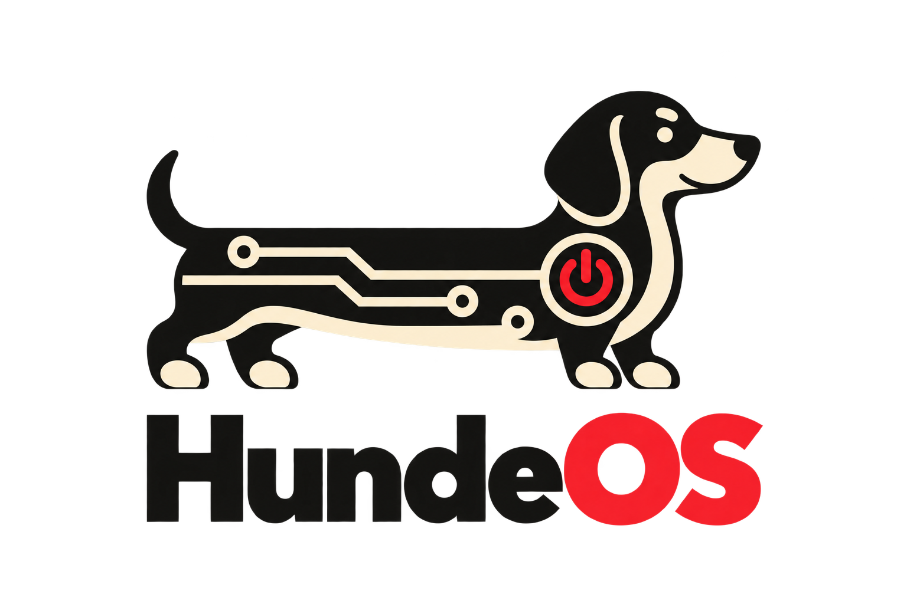

# HundeOS

HundeOS is an experimental open-source microkernel operating system written in
C and Rust for AArch64 and RISC-V. It explores a small privileged kernel,
userspace services and drivers, and POSIX compatibility for running existing
software, including Bash and OpenBSD commands.

The kernel manages scheduling, processes, address spaces, memory protection,
IPC, and interrupt routing. Filesystems, device drivers, and normal application
I/O run in userspace, communicating through authenticated Channels and managed
shared memory.

## Tested Platforms

- **QEMU AArch64 `virt`**: interactive userspace on four virtual CPUs, with
  TCG and macOS HVF configurations.
- **QEMU RISC-V `virt` (RV64)**: interactive userspace on four harts through
  OpenSBI, with Sv39 virtual memory.
- **Milk-V Duo S**: successfully tested on physical hardware. See the
  [board guide](docs/platforms/milkv-duo-s.md) for AArch64 and RISC-V build
  targets, SD images, serial connections, and platform-specific status.

AMD64 is a future goal.

## Developer Setup

Build-time dependencies include Make, a native C compiler, a target GCC/binutils
cross toolchain, LLVM/Clang and LLD, Rustup, **Python 3.12 or newer**, `uv`, and
ImageMagick. Running QEMU and building disk images also requires QEMU,
`dosfstools`, and an EXT2 image builder (`genext2fs` by default).
Board images have additional packaging requirements described in the board guide.

On macOS, install Xcode Command Line Tools and the Homebrew packages:

```sh
xcode-select --install
brew install aarch64-elf-gcc riscv64-elf-gcc riscv64-elf-binutils llvm lld qemu dosfstools genext2fs uv imagemagick
```

On Debian/Ubuntu, install the native tools and RISC-V cross toolchain:

```sh
sudo apt install build-essential gcc-riscv64-unknown-elf binutils-riscv64-unknown-elf clang lld qemu-system-arm qemu-system-misc dosfstools genext2fs imagemagick curl
curl -LsSf https://astral.sh/uv/install.sh | sh
```

For AArch64, also install a bare-metal GCC/binutils cross toolchain.
Package availability depends on the distribution. The Makefile defaults to
`aarch64-elf-` and `riscv64-elf-` tool prefixes. Override `CROSS_COMPILE`
when the installed toolchain uses a different prefix, for example:

```sh
make ARCH=riscv64 CROSS_COMPILE=riscv64-unknown-elf- kernel
```

Install Rustup separately and ensure `cargo` and `rustup` are on `PATH`.
The repository's `rust-toolchain.toml` selects the pinned toolchain, Rust source,
Rustfmt, Clippy, and bare-metal targets.

### Python Environment

Python is required by the build itself for code and asset generation, archive
and disk-image tooling, and test runners. Dependencies are declared in
[`pyproject.toml`](pyproject.toml) and resolved in `uv.lock`.

From the repository root:

```sh
uv python install 3.12
make python-venv
uv run python --version
```

`make python-venv` runs `uv sync` to create or update `.venv`. Make targets
that use Python prepare this environment automatically. Use `uv run python`
for direct script and pytest invocations; activating the environment manually
is optional. Rust build scripts also invoke `python3` and `clang` directly, so
both commands must be available on `PATH`, including when running Cargo without
`uv run`.

## Build And Run

Build the kernel and userspace for the default AArch64 target or for RISC-V:

```sh
make kernel
make ARCH=riscv64 kernel
```

Build outputs are separated by architecture and platform, for example
`build/aarch64/qemu_virt` and `build/riscv64/qemu_virt`.

Run a complete system in QEMU:

```sh
make qemu-virt
make qemu-riscv64
```

See [Running in QEMU](docs/platforms/qemu.md) for acceleration, tracing, CPU-count variants,
disk images, and emulator-specific configuration. For physical hardware, follow
the [Milk-V Duo S guide](docs/platforms/milkv-duo-s.md).

## Testing

Run hosted Rust tests, Python tooling tests, and C unit tests:

```sh
make test
```

Run just the Rust workspace or Python tooling tests:

```sh
make rust-test
uv run python -m pytest test/tools
```

Python/pytest also drives full-system smoke and integration tests: it builds and
boots QEMU, logs in, runs shell commands, and checks filesystem, procfs,
socket/pipe, process, and shutdown behavior.

```sh
make smoke-test
# Equivalent direct invocation:
uv run python -m pytest test/smoke -v
```

The parametrized AArch64 tests use macOS HVF and require an Apple Silicon Mac.
The RISC-V tests use QEMU TCG. To select a target or a single integration test:

```sh
uv run python -m pytest test/smoke -v -k riscv64
uv run python -m pytest 'test/smoke/test_qemu.py::test_qemu_rust_procfs_component[riscv64]' -v
```

The smoke suite is separate from `make test`. It requires cross compilers,
QEMU, and disk-image tools, and can take several minutes per boot. Run it
serially: tests share build images and trace paths. See the
[QEMU guide](docs/platforms/qemu.md#smoke-and-integration-tests) for trace locations.

## Development

```sh
make format          # Format C and Rust
make format-check    # Check formatting
make hundelint       # Project lint and Rust Clippy
make compile-commands
make clean           # Remove generated build artifacts
```

Formatting uses clang-format from the Python environment and Rustfmt from the
pinned Rust toolchain. Regenerate the compilation database after adding or
removing source files.

## Project Documentation

- [Documentation index](docs/README.md), including separate
  [kernel](docs/architecture/kernel/README.md) and
  [userspace services and drivers](docs/architecture/userspace/README.md) guides.
- [Goals](docs/GOALS.md) and [TODO](docs/TODO.md): project direction, remaining
  work, and open design questions.
- [Userspace I/O](docs/architecture/userspace/io-system.md): service ownership, mounts,
  filesystem and stream protocols.
- [I/O and driver hosts](docs/architecture/userspace/io-driver-hosts.md),
  [Channels](docs/architecture/kernel/channels-and-event-queues.md), and
  [shared buffers](docs/architecture/userspace/shared-buffers.md): detailed architecture.
- [Process registry and procfs](docs/architecture/userspace/process-registry-and-procfs.md):
  process files, `ps`, CPU and memory accounting, and diagnostics.
- [Running in QEMU](docs/platforms/qemu.md) and
  [Milk-V Duo S](docs/platforms/milkv-duo-s.md): platform guides.
- [Assets](assets/README.md): project-owned logos and panic artwork, preserved
  independently of build output.

Core kernel code lives in `kernel/`, target integration in `arch/`, shared
types in `common/`, userspace in `user/`, and tests in `test/`.

## License

Project-owned work is available under the [MIT License](LICENSE).
Third-party code, fonts, and other bundled materials retain their respective
licenses and copyright notices; see the notices included with those components,
including under `vendor/`. The MIT license does not override those terms.
